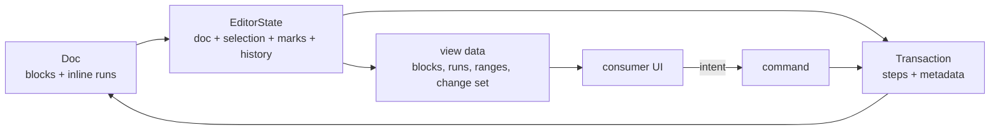

<div align="center">

# rich-editor-auy

**A headless, deterministic, accessible-by-construction rich-text engine for Rust.**
Structured content, invertible edits, canonical bytes, semantic accessibility — no DOM, no runtime,
no UI opinions.

`Rust 1.99` pin · `MSRV 1.92` · edition 2024 · `no_std + alloc` · `MIT OR Apache-2.0`

</div>

> **Status:** MVP implementation (F0–F3.5 materialized; wire/limits/a11y hardening applied; F4 performance measurement in progress with open items). The Rust core,
> WASM artifact, Deno/JSR packages, DOM adapter, Composer package and CLI are present. `make check`
> is the local gate; measured performance deviations and open design items live in
> [`DIVERGENCES.md`](DIVERGENCES.md). The planning documents are written in Portuguese; the public
> API and rustdoc are in English.

**AUY** stands for **accessibility + universality**: universal accessibility is a core invariant,
not an adapter option. The core projects a deterministic semantic tree; the adapter maps it to
native/ARIA and the host audits the rendered experience.

---

## What it is

`rich-editor-auy` treats a rich-text document as a **canonical immutable value with an algebra of
editing**:

- a tree of blocks with **flat inline content** (marks are run metadata, not nodes);
- a schema that validates content expressions, marks, attributes and invariants;
- small **steps** that can be applied, inverted and mapped (the basis for undo, history,
  decorations and collaboration);
- atomic transactions that produce a new state and a compact change set for the UI;
- deterministic, byte-stable JSON (plus a versioned envelope with a schema fingerprint);
- a deterministic **semantic accessibility tree** (`A11yTree`): roles, names, `alt`, `lang`/`dir`,
  reading order and validation live in the core, not in the UI;
- zero `unsafe`, zero panics on untrusted input, one audited normal dependency (`blake3`,
  `no_std`/`pure`) and no runtime or UI dependency.

A UI — web, canvas, native, terminal, server — is a client: it translates events, lays out, paints
and owns I/O. The core owns the document, the edit algebra, the bytes and the **semantic
accessibility tree**; the adapter maps that tree to native elements/ARIA; the host audits contrast,
focus and WCAG. Accessibility is a core invariant, not an optional adapter feature. The library
never styles that UI: no CSS, no classes, no wrapper.

## What it is not

Not a component, not a framework, not a DOM `contenteditable` wrapper, not a layout engine, not a
CSS theme, not a sanitizer, not a persistence layer, not a collaboration server. It is also not an
accessibility overlay: semantic roles, names and `alt` live in the document and schema, not patched
into the DOM after the fact. Everything else (layout, styling, persistence, collaboration) is a
consumer concern or a separate crate (post-MVP).

## Design at a glance



- **Document:** block tree; each textblock holds a flat sequence of runs with a mark set.
- **Positions:** UTF-8 byte offsets plus one token per structural open/close/atom; the UI converts
  to its own units (UTF-16, graphemes) explicitly.
- **Editing:** closed `Step` enum (`Replace`, `ReplaceAround`, `AddMark`, `RemoveMark`,
  `SetNodeAttr`, `SetDocAttr`) with `apply`/`invert`/`map`.
- **Ownership:** `Arc` + copy-on-write; the common path mutates in place when uniquely owned.
- **Bytes:** compact canonical JSON, schema-ordered attributes and marks, no floats, no `HashMap`.
- **Bytes and hashes:** BLAKE3-256 is the only project hash (schema fingerprint, envelope digest,
  integrity), with domain separation; no FNV or SHA-256.
- **Rigor:** `forbid(unsafe_code)`, deny `unwrap`/`expect`/`panic` even in tests, no clock/env/RNG
  in the core, 300-line file gate, allocation/instruction budgets, package/publish gates.

## Integration

Canonical JSON is the cross-language ABI. PHP stores and transports bytes; TypeScript runs the core
as WASM. Neither SDK reimplements the schema or the edit algebra. The official distribution is a
crates.io crate, a WASM artifact, a Composer package and a Deno 2.0/JSR workspace.

- **TypeScript/Deno 2.0:** `@rich-editor-auy/core` (WASM, no DOM), `@rich-editor-auy/dom`
  (required adapter for UI; it does not reimplement semantics), `@rich-editor-auy/schema` (presets
  that emit canonical JSON). The packages are published to **JSR** from `packages/ts`.
- **PHP:** the thin Composer package `rich-editor-auy/php` for envelope, byte-preserving documents
  and optional CLI validation. No HTML renderer, no schema engine.
- **Zero styling:** the adapter uses semantic native elements by default (`neutral` is opt-in),
  `data-auy-*` and an `A11yTree` mapping. No CSS, no `class`, no `style`, no wrapper; `destroy()`
  restores the host.
- **References:** `DocId`/`NodeId` + typed `RefTarget`; the core preserves and validates shape, the
  optional `refs` crate resolves a corpus, backlinks and dangling targets.
- **Accessibility (AUY):** the core supplies the semantic tree, names/`alt`/`lang`/`dir`/order and
  validation; the adapter maps roles to native/ARIA and handles keyboard/focus/IME; the consumer
  owns contrast, focus styles and the final WCAG audit. There is no `aria: false` opt-out; `data`
  explicitly transfers rendering responsibility.

```ts
import { EditorState, init } from "@rich-editor-auy/core";
import { mount } from "@rich-editor-auy/dom";

await init();
const state = EditorState.fromJSON(savedJSON);
const editor = mount(host, {
  state,
  label: "Documento",
  onInput: (_event, current) => save(current.doc().toJSON()),
});
```

`onInput` is an intent boundary: the adapter does not reimplement the edit algebra. The host
applies core commands and calls `editor.dispatch(nextState)`.

No CSS import. The host remains yours.

## Planning dossier

| Document | Question |
|---|---|
| [`plan/00_panorama.md`](plan/00_panorama.md) | What is the thesis, scope and kill criteria? |
| [`plan/01_referencias.md`](plan/01_referencias.md) | What did ProseMirror, Lexical, Quill, TipTap, taino-edit, knudge and html-auy teach? |
| [`plan/02_decisoes.md`](plan/02_decisoes.md) | Which decisions are open, with options and recommendations? |
| [`plan/03_decisoes-fechadas.md`](plan/03_decisoes-fechadas.md) | What is already closed and cannot regress? |
| [`plan/04_arquitetura.md`](plan/04_arquitetura.md) | How do the pieces fit, with types and flows? |
| [`plan/05_desempenho.md`](plan/05_desempenho.md) | What is the performance budget and how is it measured? |
| [`plan/06_api-e-integracao.md`](plan/06_api-e-integracao.md) | What does a UI receive and what must it do? |
| [`plan/07_rigor.md`](plan/07_rigor.md) | Which toolchain, lints, CI and tests are mandatory? |
| [`plan/08_roadmap.md`](plan/08_roadmap.md) | In what order, with which acceptance and stop criteria? |
| [`DIVERGENCES.md`](DIVERGENCES.md) | Where does the implementation differ from the plan, and why? |
| [`plan/09_frontend-e-referencias.md`](plan/09_frontend-e-referencias.md) | How do PHP/TS integrate without CSS, and how do cross-publication references work? |
| [`plan/10_acessibilidade.md`](plan/10_acessibilidade.md) | What does AUY mean, which a11y contract is core, and how is it tested? |
| [`AGENTS.md`](AGENTS.md) | How does an agent/contributor operate in this repository? |

The raw exploration lives in [`plan/brainstorm/`](plan/brainstorm/): model alternatives and the
catalog of Unicode/selection/schema/wire edges with the test that must lock each one.

## License

Intended license: **MIT OR Apache-2.0** (decision F05). The seed repository currently carries the
Apache-2.0 text in [`LICENSE`](LICENSE); F0 adds `LICENSE-MIT` and `LICENSE-APACHE` before the first
public release.
