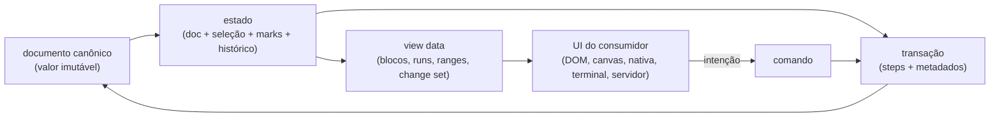
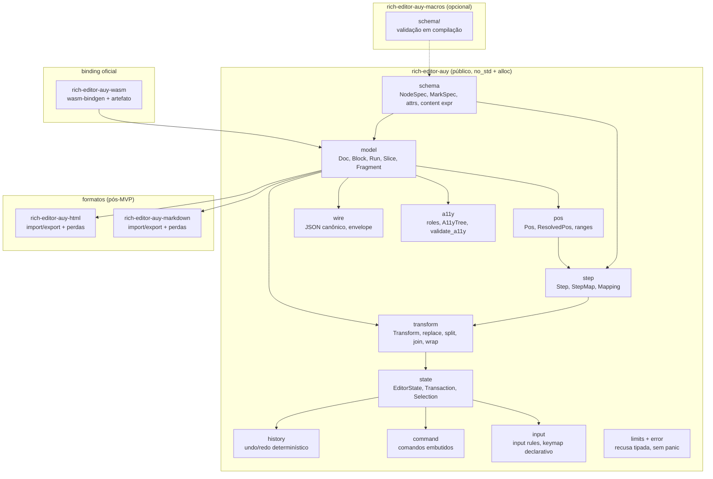
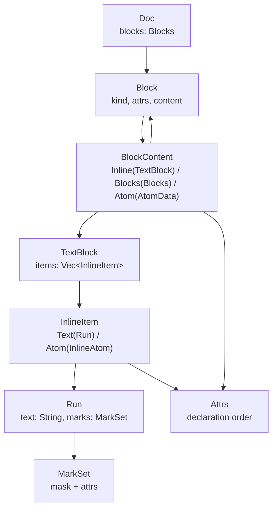

# 00 — Panorama: um editor de texto rico como álgebra de dados

> **Status:** dossiê de planejamento. Nada aqui é código; é o contrato que o código terá de
> cumprir. As decisões numeradas vivem em [`02_decisoes.md`](02_decisoes.md) e
> [`03_decisoes-fechadas.md`](03_decisoes-fechadas.md); a exploração crua, em
> [`brainstorm/`](brainstorm/).

---

## 1. A tese

Um editor de texto rico é, antes de tudo, **um banco de dados de conteúdo estruturado com uma
álgebra de edição**. A interface gráfica é um cliente desse banco: ela desenha, mede, posiciona o
cursor, recebe teclas e pinta seleção, mas não é dona da verdade. A verdade é o documento — e o
documento precisa ser:

1. **estruturado** (schema explícito, não HTML arbitrário nem DOM);
2. **canônico** (uma única representação válida para o mesmo conteúdo);
3. **imutável do ponto de vista do consumidor** (um valor, não um objeto mutável compartilhado);
4. **editável por uma álgebra pequena** (steps invertíveis e mapeáveis);
5. **determinístico** (mesmos dados + mesmas operações = mesmos bytes, em qualquer máquina);
6. **barato** (editar um caractere não pode custar o documento inteiro);
7. **acessível por construção** (roles semânticas, nomes/`alt`, `lang`/`dir`, ordem de leitura e
   validação no core; acessibilidade não é camada opcional nem pós-MVP).

O `rich-editor-auy` existe para tornar esses sete pontos explícitos, testáveis e rápidos. O nome
**AUY** significa **acessibilidade + universalidade**: acessibilidade universal. O "auy" segue a
família do [`html-auy`](../ref/html-auy/): a mesma desconfiança de representações ambíguas, a mesma
preferência por tipos e bytes canônicos, o mesmo corte de escopo ("o crate garante o que o
compilador consegue recusar; o resto é gate que falha").

### 1.1 A inversão que define o projeto

A maioria dos editores começa pela UI e trata o documento como consequência da árvore do DOM (ou
de um VDOM, ou de um estado mutável de componente). Aqui a ordem é invertida:

A UI nunca muta o documento. Ela produz uma **intenção** (inserir texto, dividir bloco, aplicar
marca, colar um slice), o core produz uma **transação**, a transação produz um **novo estado**, e a
UI recebe um **change set** para atualizar apenas o que mudou.

### 1.2 Por que "headless" não é "sem opinião"

Headless significa que o core não conhece pixels, fontes, DOM, `contenteditable`, IME do sistema,
clipboard do sistema ou ARIA. Isso não significa que ele não tenha opinião sobre o que é um
documento válido. Pelo contrário: é justamente por não desenhar que ele pode ser **mais rigoroso**
com o modelo, com a álgebra de edição e com o contrato de bytes. O consumidor escolhe a UI; o core
escolhe as invariantes.

---

## 2. O problema, com precisão

### 2.1 Editores acoplados ao DOM pagam o preço no modelo

No Summernote, a fonte da verdade é o DOM editável e as operações usam `document.execCommand`
([`ref/summernote/src/js/module/Editor.js`](../ref/summernote/src/js/module/Editor.js)). O
resultado é previsível: não existe uma representação canônica, o undo é uma pilha de snapshots de
HTML, a validação depende do navegador e a serialização é "o que o DOM virou". É um produto que
funciona, mas o modelo é o navegador — e o navegador não é um modelo de dados.

O Quill melhora isso com `Parchment` (uma árvore de *blots*) e `quill-delta` para mudanças
([`ref/quill/packages/quill/src/core/quill.ts`](../ref/quill/packages/quill/src/core/quill.ts)),
mas a árvore ainda é a árvore de blots do DOM e o documento não é um valor canônico independente da
renderização. A lição positiva: **Delta é uma álgebra de mudança excelente** (retain/insert/delete
com atributos), e vale absorver a ideia de change set compacto. A lição negativa: não deixar o
modelo depender da árvore de renderização.

### 2.2 Editores acoplados a um runtime JS pagam o preço na fronteira

ProseMirror, Lexical e TipTap são excelentes e provam o desenho:

- **ProseMirror** tem exatamente a arquitetura que queremos: documento como árvore de blocos com
  conteúdo inline **plano** (marks como metadado, não como nós), uma única representação válida,
  posições como offsets, steps pequenos com `apply`/`invert`/`map`, `Mapping` com viés, e
  transações ([guia oficial](https://prosemirror.net/docs/guide/)).
- **Lexical** separa `EditorState` imutável, usa *node keys* estáveis para identidade de UI e
  faz *double buffering* de updates ([`ref/lexical/AGENTS.md`](../ref/lexical/AGENTS.md)).
- **TipTap** é a prova de mercado do formato "headless toolkit + extensões" e mostra que o
  consumidor quer pacotes pequenos e composáveis ([`ref/tiptap/AGENTS.md`](../ref/tiptap/AGENTS.md)).

Mas todos exigem um runtime JavaScript e um grafo de dependências que o consumidor pode não querer
(SSR, WASM, nativo, embedded, CLI, servidor). E nenhum deles oferece **bytes canônicos** como
contrato de biblioteca, **no_std + alloc**, **orçamento de alocação** ou **schema validado em
compilação** para o consumidor Rust.

### 2.3 Em Rust, o espaço ainda está aberto

O `taino-edit` é o exemplo mais próximo: um porte do ProseMirror para Rust, com 6.667 linhas no
core (`wc -l` em [`ref/taino-edit/crates/taino-edit-core/src`](../ref/taino-edit/crates/taino-edit-core/src)),
`Arc<Node>` por nó, `Box<dyn Step>` para steps, posições em `char` (escalares Unicode), `HashMap`
no schema, `serde_json`/`regex`/`pulldown-cmark` como dependências e adaptadores para Leptos e
Dioxus. É uma referência valiosa de **forma** e um catálogo de **custos**:

| Escolha do taino-edit | Consequência | O que faremos diferente |
|---|---|---|
| `Arc<Node>` por nó, com `Fragment` de `Vec<Node>` | snapshots baratos; editar um filho clona o vetor de irmãos e o caminho até a raiz; tabela grande paga O(irmãos) | topo como `Vec<Arc<Block>>` + COW; blocos folha mutáveis quando únicos; chunking se medido |
| `Box<dyn Step>` | uma alocação por step, dispatch dinâmico, `match` impossível de esgotar | `enum Step` fechado, `Copy` quando couber, serialização direta |
| posições em `char` | indexar texto custa O(n); converter para bytes/UTF-16 custa outra varredura | posição em **byte UTF-8** + conversão explícita para unidades da UI |
| `HashMap` no schema | ordem de iteração não determinística; schema fingerprint impossível | `Vec` ordenado por declaração + `BTreeMap` só onde necessário |
| `serde_json` no core | sem `no_std`, árvore JSON intermediária, erros opacos | writer canônico próprio; parser atrás de feature; `serde` é adaptador |
| `regex` para input rules | dependência pesada para `## ` e `- ` | matcher literal/prefixo pequeno; regex é feature opcional |
| sem orçamento de alocação/tempo | performance é "parece rápido" | testes de contagem de alocação + `iai-callgrind`, não só `criterion` |

A conclusão não é "reescrever o taino-edit". É que **o espaço de um engine Rust headless, canônico
e com orçamento ainda não está ocupado** — e que o taino-edit oferece um excelente mapa de onde as
pedras estão.

### 2.4 O que falta, em uma frase

Falta um engine que trate o documento como **valor canônico e persistente**, a edição como
**álgebra de steps**, o schema como **contrato construído e validado**, e o desempenho como
**orçamento medido** — sem DOM, sem runtime, sem `unsafe`, sem panic, sem dependência de runtime/UI.
`blake3` é a única dependência normal externa do core, auditada e `no_std` (F30).

---

## 3. O que o projeto é e não é

| É | Não é |
|---|---|
| Engine headless de documento rico | Componente visual, editor pronto, tema, CSS |
| Modelo de dados + schema + transações + histórico | Framework de UI, VDOM, framework reativo |
| Biblioteca `no_std + alloc`, zero `unsafe` | Runtime JS no core; WASM é binding oficial separado, não requisito do core |
| Serialização canônica e determinística | Sanitizador de HTML de terceiros |
| Import/export com relatório de perdas | Parser HTML "perfeito" ou navegador |
| Álgebra de steps pronta para colaboração | Servidor de colaboração, CRDT embutido no core |
| Camada de comandos e input rules determinística | Keymap de sistema operacional, atalhos globais |
| Unidades lógicas (posições, ranges, marks) | Layout, fontes, shaping, bidi visual, hit testing |
| Contrato de bytes e fingerprint de schema | Persistência, I/O, banco de dados, rede |
| Integração por JSON canônico + WASM + adaptador zero-CSS | UI kit, CSS, wrapper, CMS, componente visual |

### 3.1 Não-objetivos permanentes

1. **Não renderizar.** O core não sabe o que é um pixel, uma fonte, uma linha visual ou um glifo.
   Posições são lógicas; a UI mapeia para geometria.
2. **Não ler I/O.** Nada de arquivo, rede, clipboard, relógio, ambiente ou processo. O consumidor
   lê e escreve; o core transforma valores.
3. **Não conhecer DOM.** Nem `contenteditable`, nem `Selection`, nem `Range`, nem `MutationObserver`.
   O adaptador web é do consumidor (ou de um crate separado, pós-MVP).
4. **Não ser um framework de plugins.** O MVP oferece pontos de extensão declarativos (schema,
   comandos, input rules, decorações calculadas); um registry genérico de plugins é dívida
   adiada até haver evidência de que o custo se paga.
5. **Não colocar colaboração no core.** O modelo de steps é desenhado para permitir rebase/OT/CRDT,
   mas o core não carrega IDs de CRDT nem relógios vetoriais. Isso é um crate separado, se e quando.
6. **Não prometer ARIA, foco ou contraste renderizados.** O core **possui** a acessibilidade
   semântica: roles, nomes, `alt`, `lang`/`dir`, ordem de leitura, ranges e `validate_a11y`. O
   adaptador traduz a árvore para elementos nativos/ARIA e implementa foco/teclado/IME; o host
   garante contraste, reflow e auditoria WCAG. A camada muda, a responsabilidade não: a11y é
   invariante de core, não “feature do adaptador”.
7. **Não ter formato binário como cidadão de primeira classe no MVP.** JSON canônico é o contrato;
   binário é otimização posterior, atrás de codec.
8. **Não ter "modo lossy" silencioso.** Importação que perde informação devolve um relatório
   explícito de perdas; o default é estrito.
9. **Não emitir CSS, `class`, `style` ou wrapper.** O core não conhece DOM; o adaptador de UI
   renderiza dados e mapeia a `A11yTree` para nativo/ARIA, nunca uma folha de estilo. "Não
   interferir na estilização" é contrato, não cortesia.

---

## 4. Princípios

### P0 — Acessibilidade universal é invariante de core
Toda decisão deve responder como o documento é percebido, navegado e anunciado sem depender de
pixels, cor, ponteiro, hover ou áudio. O core projeta uma **árvore semântica determinística**
(`A11yTree`), valida nomes/`alt`/`lang`/`dir`/estrutura e preserva ranges para anúncio. O adaptador
mapeia a árvore para elementos nativos/ARIA; o host audita contraste, foco e WCAG. A11y não é flag,
não é feature opcional e não entra “depois”; ela entra no schema desde o primeiro nó.

### P1 — O documento é um valor, não um objeto
`Doc` é imutável para o consumidor. Toda mudança produz um novo `Doc` por uma transação. O
compartilhamento estrutural é interno (COW/Arc) e não vaza para a API como mutabilidade.

### P2 — Uma única representação válida
Texto adjacente com as mesmas marcas é um único run; run vazio não existe; marca fora da ordem do
schema não existe; atributo omitido quando é default; nenhuma estrutura vazia que o schema não
permita. `normalize` é total, pura e idempotente.

### P3 — Edição é álgebra, não cirurgia
Toda mudança é um `Step` pequeno, serializável, invertível e mapeável. `Transform` compõe steps;
`Mapping` reposiciona seleção, decorações e steps concorrentes. Não há "mutar o nó no lugar" na
API pública.

### P4 — O schema é o contrato
Tipos de nó, conteúdo permitido, grupos, marcas permitidas, exclusividade de marcas, atributos e
defaults são declarados uma vez. O schema é validado na construção (não no primeiro documento) e
produz um fingerprint determinístico. A macro `schema!` é um front-end validado em compilação para
o mesmo schema de runtime; não é uma segunda fonte de verdade.

### P5 — Prevenção acima de detecção
Se um estado inválido pode ser impedido por tipo, construção ou API ausente, ele é impedido.
Exemplos: não existe `TextRun` com texto vazio; não existe `Pos` fora dos limites do documento
sem passar por `resolve`; não existe `Slice` com profundidades abertas maiores que a árvore; não
existe `Step` que apague metade de um token estrutural.

### P6 — Determinismo de bytes
Mesmo conteúdo + mesmo schema = mesmos bytes. Ordem de atributos, marcas, nós e arrays é canônica.
Nada de `HashMap`, relógio, ambiente, RNG ou float no caminho de serialização. O fingerprint do
schema e o hash do documento são **BLAKE3-256** com domain separation e estáveis entre máquinas,
execuções e `wasm32`.

### P7 — Desempenho é orçamento
Editar um caractere em um documento de 1 MB não pode alocar o documento inteiro. As metas são
medidas com contagem de alocação e contagem de instruções (`iai-callgrind`), não com "parece
rápido". Benchmarks de parede são informativos; os gates determinísticos são os de alocação,
visitas de nó e instruções.

### P8 — Zero `unsafe`, zero panic, zero `unwrap`
`forbid(unsafe_code)`. Toda entrada não confiável (JSON, slice colado, documento persistido) é
validada e pode falhar com erro tipado. Um panic no core é bug, não tratamento de erro. O mesmo
vale para testes: `?`, `matches!` e `let else`, não `unwrap`/`expect`.

### P9 — Fronteira explícita
O core não adivinha o que é da UI. Seleção é lógica; layout é do consumidor. IME é um protocolo
de eventos que a UI traduz; o core não chama APIs do sistema. A documentação diz o que o core
garante e o que ele não garante.

### P10 — Uma peça, um dono
Schema em um lugar; normalização em um lugar; mapeamento em um lugar; serialização em um lugar.
Não há segunda tabela de elementos, segundo parser de JSON ou segunda regra de "o que é um run".
Mudança de contrato exige decisão registrada.

### P11 — O projeto pode morrer barato
Marcos com critérios numéricos. Se o modelo não entregar edição sub-microssegundo em 1 MB, se o
schema macro custar mais do que economiza, ou se a complexidade de Unicode comer o orçamento, o
projeto para e o que existe é vendorizado. Não há obrigação de virar produto.

### P12 — Nada de açúcar que esconde preço
Toda economia de digitação precisa ser explicável em uma linha. Um atalho para "inserir parágrafo"
é bom; um "plugin mágico que busca dados" não é. A API pública é pequena e nomeada; o resto é
composição.

### P13 — Zero estilo, integração por dados
O core não conhece DOM e não emite CSS. O adaptador de UI não usa `class`, `style` ou wrapper: ele
usa semântica nativa (ou `neutral` explícito), `data-auy-*` e mapeia a `A11yTree`, e o consumidor é
dono do CSS. O contrato com PHP e TypeScript é o JSON canônico; WASM e o adaptador DOM são pacotes
separados. Se uma feature exige uma folha de estilo ou um componente visual para funcionar, ela está
fora do core.

---

## 5. Arquitetura em uma página

Regras do grafo:

- `rich-editor-auy` só depende de `blake3` (`no_std`, `pure`) além de `alloc` em builds normais
  (F20/F30). Nenhum runtime, parser ou framework entra no core.
- `rich-editor-auy-macros` é opcional e só depende do `rich-editor-auy` para emitir chamadas ao
  builder; é publicado separadamente porque uma proc-macro não pode ser dependência normal do
  crate que ela estende.
- `formatos` são crates separados, com dependências próprias (parser HTML/Markdown), e não
  contaminam o core. Eles devolvem `(Doc, ImportReport)`; nunca perdem dados em silêncio.
- `a11y` é módulo do core, não crate opcional: `A11yRole`/`A11ySpec` fazem parte do schema e
  `Doc::a11y_tree`/`validate_a11y` são API de primeira classe. O adaptador mapeia a árvore; não
  inventa semântica.
- `fuzz/`, `bench/`, `ref/` e `packages/` não são membros do workspace Cargo; `packages/ts` e
  `packages/php` são subprojetos oficiais com seus próprios gates (F31).

## 6. Modelo de dados em uma página

O modelo é **dois níveis**, como o ProseMirror descreve: uma árvore de blocos com folhas
*textblock* cujo conteúdo inline é uma **sequência plana** com marcas como metadado, não uma
árvore de nós. Isso dá três coisas ao mesmo tempo:

1. posições dentro de um parágrafo são um offset, não um caminho de árvore;
2. aplicar/remover marca é dividir runs, não reestruturar nós;
3. a UI recebe runs prontos para desenhar, sem reconstruir a árvore de marcas.

O que o modelo **não** faz: conteúdo inline aninhado (um link contendo um bloco, uma marca contendo
outra marca como nó). Links são marcas, não nós. Se um consumidor precisar de conteúdo rico dentro
de uma anotação, isso é um bloco/átomo com conteúdo próprio, não um inline recursivo.

**Identidade e referências.** Um nó de bloco pode ter um `NodeId` opcional, guardado no atributo
reservado `id`; ele é uma âncora de publicação, não um ID de CRDT nem de renderização. `RefTarget`
(`doc`/`node`/`version`/`fragment`) vive em `AttrValue::Ref` e é preservado, não resolvido, pelo
core. `DocId` é metadado de publicação e não entra no `Doc` canônico. Ver
[`09_frontend-e-referencias.md`](09_frontend-e-referencias.md) §6.

## 7. Contrato de desempenho em uma página

| Operação | Cenário | Alvo (release, x86_64) | Gate |
|---|---|---|---|
| Inserir 1 caractere | doc de 1 MB, dono único, run ≤ 4 KB | ≤ 200 ns, 0 alocação após warm-up | contagem de alocação + `iai-callgrind` |
| Inserir 1 caractere | mesmo doc, com snapshot retido (COW) | ≤ 10 µs, ≤ 2 alocações + cópia do vetor de blocos | contagem de alocação + bench |
| Aplicar `AddMark` | seleção de 10 KB | ≤ 5 µs, alocações ≤ nº de runs divididos | contagem de alocação |
| Mapear posição | transação de 10 steps | ≤ 50 ns | `iai-callgrind` |
| Serializar JSON canônico | doc de 1 MB | ≤ 5 ms | `iai-callgrind` + bench |
| Parsear JSON | doc de 1 MB | ≤ 15 ms | bench + fuzz |
| Validar documento | doc de 1 MB | ≤ 10 ms | bench |
| Memória | doc de 1 MB | ≤ 2,0× bytes de texto + 64 B/bloco + 24 B/run | teste de memória |

Números são **alvos a calibrar** em [`05_desempenho.md`](05_desempenho.md); o que não é calibrável é
a regra: **nenhuma operação de edição pode ser O(documento) no caminho comum**. O caminho comum é
dono único; o caminho com snapshot paga uma cópia de ponteiros, não de conteúdo.

## 8. Critérios de sucesso e de abandono

### 8.1 Sucesso (M1–M3, detalhados em [`08_roadmap.md`](08_roadmap.md))

1. **M1 — modelo e álgebra:** schema, doc, posições, normalização, JSON canônico, steps, mapping,
   seleção. Testes de propriedade e diferencial verdes. Edição de 1 caractere em 1 MB dentro do
   orçamento.
2. **M2 — edição utilizável:** histórico, comandos, input rules, IME, change sets. Um harness
   headless simula 10.000 operações aleatórias sem divergência, panic ou perda de invariantes.
3. **M3 — confiança:** orçamentos de alocação/instrução no CI, fuzz sem panic, Miri, MSRV, docs,
   `make check` verde do zero. A API pública é pequena o suficiente para ser documentada em uma
   página.

### 8.2 Abandono (kill criteria)

O projeto para — sem drama, e o que existe fica como registro — se qualquer um ocorrer:

1. uma edição de 1 caractere em 1 MB não couber em **10 µs** ou exigir mais de **3×** o texto em
   memória;
2. o modelo não conseguir garantir `apply(invert(step)) == identidade` para o subconjunto
   documentado, mesmo com testes diferenciais;
3. o schema macro custar mais LOC/manutenção do que o builder equivalente, sem ganho de segurança
   demonstrável;
4. a fronteira headless não se sustentar: o core precisar de DOM, layout ou I/O para funcionar
   (sinal de que o escopo estava errado);
5. o custo de manutenção do parser/JSON/normalização superar o custo dos defeitos que ele evita
   em dois ciclos de atualização de `rustc`.

---

## 9. Glossário

| Termo | Definição |
|---|---|
| **Doc** | Documento imutável: árvore de blocos + conteúdo inline plano. |
| **Block** | Nó estrutural (parágrafo, heading, lista, citação, tabela, átomo de bloco). |
| **TextBlock** | Bloco folha com conteúdo inline. |
| **Run** | Trecho de texto com o mesmo conjunto de marcas. |
| **Mark** | Anotação inline (forte, ênfase, link, código) com tipo e atributos opcionais. |
| **MarkSet** | Conjunto canônico e ordenado de marcas de um run. |
| **Schema** | Declaração de tipos de nó/marca, conteúdo, grupos, atributos e invariantes. |
| **AUY** | Acessibilidade + universalidade: acessibilidade universal como invariante de core. |
| **A11yTree** | Projeção semântica determinística do `Doc`: roles, nomes, `alt`, `lang`/`dir`, texto/marcas, mídia, níveis, ranges e filhos. Não é wire nem DOM. |
| **A11yIssue** | Diagnóstico estável (`código`, severidade, path/range e argumentos) de acessibilidade; a mensagem localizada é do CLI/adaptador. |
| **Pos** | Offset lógico no *token stream* do documento (bytes de texto + tokens estruturais). |
| **Step** | Mudança atômica, pequena, invertível e mapeável. |
| **Transform** | Composição de steps sobre um documento. |
| **Transaction** | Transform + seleção + metadados de origem/histórico. |
| **Mapping** | Composição de mapas de posição, com viés e recuperação de deleção. |
| **Slice** | Fragmento com profundidades abertas, para colar/dividir nas bordas. |
| **Selection** | Caret, intervalo de texto ou nó selecionado, com viés de associação. |
| **EditorState** | Doc + seleção + marks armazenadas + histórico + metadados de composição. |
| **ChangeSet** | Lista compacta de ranges antigos/novos afetados, para a UI invalidar. |
| **Fingerprint** | BLAKE3-256 determinístico da declaração do schema (64 hex), não assinatura. |
| **Envelope** | Formato persistido: versão + fingerprint BLAKE3-256 + documento canônico. |
| **ImportReport** | Relatório explícito de construções mapeadas, aproximadas e descartadas. |
| **Headless** | Sem DOM, layout, fontes, I/O ou APIs do sistema. |

---

## 10. Mapa de leitura

| Documento | Pergunta que responde |
|---|---|
| [`01_referencias.md`](01_referencias.md) | O que cada projeto de referência ensina e onde ele erra? |
| [`02_decisoes.md`](02_decisoes.md) | Quais decisões estão abertas, com opções e recomendação? |
| [`03_decisoes-fechadas.md`](03_decisoes-fechadas.md) | O que já está decidido e não se rediscute sem nova entrada? |
| [`04_arquitetura.md`](04_arquitetura.md) | Como as peças se encaixam, com tipos e fluxos? |
| [`05_desempenho.md`](05_desempenho.md) | Qual é o orçamento e como ele é medido? |
| [`06_api-e-integracao.md`](06_api-e-integracao.md) | O que a UI recebe, o que ela deve fazer e o que o core não faz? |
| [`07_rigor.md`](07_rigor.md) | Quais lints, toolchain, CI e testes são obrigatórios? |
| [`08_roadmap.md`](08_roadmap.md) | Em que ordem construir, com que critérios de aceite e parada? |
| [`09_frontend-e-referencias.md`](09_frontend-e-referencias.md) | Como integrar PHP/TS sem CSS, com IDs estáveis e referências entre publicações? |
| [`10_acessibilidade.md`](10_acessibilidade.md) | O que é AUY, qual contrato semântico o core possui e como ele é validado? |
| [`brainstorm/01_modelo.md`](brainstorm/01_modelo.md) | Quais alternativas foram consideradas e por que foram rejeitadas? |
| [`brainstorm/02_bordas.md`](brainstorm/02_bordas.md) | Quais bordas (Unicode, deleção, seleção, schema) precisam de teste? |
| [`../AGENTS.md`](../AGENTS.md) | Como um agente/contribuidor opera neste repositório? |
