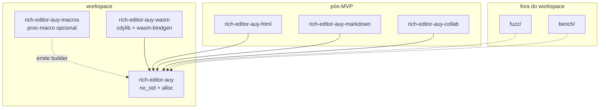

# 04 — Arquitetura proposta

> **Status:** proposta de arquitetura para ratificação. As decisões citadas (`Dxx`) estão em
> [`02_decisoes.md`](02_decisoes.md); as fechadas (`Fxx`), em
> [`03_decisoes-fechadas.md`](03_decisoes-fechadas.md). Este documento não descreve código
> existente; descreve o código que será escrito e os contratos que ele terá de cumprir.

---

## 1. Crates e grafo de dependência



| Crate | Papel | Dependências normais | Publicado |
|---|---|---|---|
| `rich-editor-auy` | modelo, schema, posições, steps, estado, histórico, comandos, wire | `blake3` (`no_std`, `pure`); nenhuma outra | sim |
| `rich-editor-auy-macros` | `schema!` e acessores tipados; front-end validado do builder | `proc-macro2`, `quote` (sem `syn`) | sim |
| `rich-editor-auy-wasm` | artefato WASM + glue `wasm-bindgen` para JSR/browser | core, `wasm-bindgen` | sim (crate) + artefato |
| `rich-editor-auy-html` | import/export HTML com `ImportReport` | parser HTML (decisão futura) | pós-MVP |
| `rich-editor-auy-markdown` | import/export Markdown com `ImportReport` | parser Markdown (decisão futura) | pós-MVP |
| `rich-editor-auy-refs` | corpus, `resolve`, backlinks, dangling, `version_mismatch` | core | pós-MVP |
| `rich-editor-auy-diff` | diff semântico entre `Doc` persistidos; `Change` estruturado | core | pós-MVP |
| `rich-editor-auy-integrity` | hash criptográfico e assinatura do `Envelope` | BLAKE3 + Ed25519 | pós-MVP |
| `rich-editor-auy-docx` / `-odf` | import/export de escritório com relatório de perdas | parsers OOXML/ODF | pós-MVP |
| `rich-editor-auy-collab` | ponte de steps para OT/CRDT | decisão futura | pós-MVP |
| `rich-editor-auy-testkit` | strategies proptest, modelo ingênuo, helpers de alocação | `proptest` (dev) | não (ou publicado à parte) |

**Regras do grafo:**

1. O core só depende de `blake3` (`no_std`, `pure`) além de `alloc` (F20/F30). Qualquer outra
   dependência normal exige decisão.
2. A macro nunca é dependência normal do core; o consumidor a habilita com `features = ["macros"]`.
3. Formatos e colaboração não são features do core; são crates separados. Isso evita que uma
   feature arraste um parser HTML para dentro de um build WASM mínimo.
4. `fuzz/` e `bench/` têm workspace próprio (nightly/`harness = false`) e não são membros. O crate
   `rich-editor-auy-wasm` é membro e é a única porta de `wasm-bindgen`.
5. A direção de dependência é sempre `formatos/colab/wasm → core`; nunca o contrário.
6. `packages/php` e `packages/ts` não são membros do workspace Cargo: são subprojetos oficiais que
   consomem o core/WASM por bytes (F31).

## 2. Mapa de módulos do core

| Módulo | Responsabilidade | Não faz | LOC alvo |
|---|---|---|---|
| `model` | `Doc`, `Block`, `TextBlock`, `Run`, `InlineItem`, iteradores, normalização, `Limits` | não conhece schema (recebe `&Schema`), não serializa | ~1.800 |
| `schema` | `DocSpec`, `NodeSpec`, `MarkSpec`, `AttrSpec`, `SchemaBuilder`, `ContentMatch`, grupos, fingerprint, `A11ySpec` | não constrói documentos | ~1.500 |
| `a11y` | `A11yRole`, `A11yNode`, `A11yTree`, `A11yIssue`, `A11yReport`, `a11y_tree`, `validate_a11y`; ordem de leitura, nomes, `alt`, `lang`/`dir`, níveis, ranges | não gera DOM/ARIA, não mede, não audita contraste/WCAG | ~400 |
| `pos` | `Pos`, `Size`, `ResolvedPos`, `Range`, `NodeRange`, conversões UTF-16/grafo | não decide seleção | ~500 |
| `step` | `Step` (enum), `Slice`, `StepMap`, `Mapping`, `apply`/`invert`/`map` | não acumula transação | ~1.200 |
| `transform` | `Transform`, `replace`, `split`, `join`, `wrap`, `lift`, `add_mark`, `remove_mark`, `set_attr` | não conhece UI | ~1.200 |
| `state` | `EditorState`, `Transaction`, `Selection`, `ChangeSet`, `stored_marks` | não guarda histórico global | ~900 |
| `history` | `History`, `Group`, política de agrupamento, undo/redo | não serializa por padrão | ~400 |
| `command` | comandos embutidos (`insert_text`, `delete`, `split_block`, `toggle_mark`, …) | não conhece keymap de SO | ~600 |
| `input` | `InputRule`, `Key`, `Keymap` declarativo | não instala atalhos globais | ~400 |
| `wire` | writer canônico, parser JSON opcional, `Envelope`, `ImportReport` | não faz I/O | ~1.100 |
| `math` | `Pos`/`Size` checked, saturating, conversões auditadas | não é álgebra genérica | ~200 |
| `motion` | grapheme/word/block boundaries, snap | não faz layout | ~300 |
| `error` | `EditError`, `SchemaError`, `StepError`, `ParseError`, `LimitError` | não usa `Box<dyn Error>` | ~400 |

**Total estimado do core:** ~10.900 LOC de produção, sem testes. É uma estimativa de ordem de
grandeza; o taino-edit core tem 6.667 LOC sem `no_std`, sem orçamento e com menos superfície de
erro. O acréscimo é o custo de rigor, determinismo e testes de borda.

## 3. Estruturas de dados

### 3.0 Regra de representação

A escolha de cada estrutura está ratificada em [`02_decisoes.md`](02_decisoes.md) §K. O resumo
operacional:

- **Ordem**: `Vec`/`Box<[T]>` na ordem do documento, do schema ou da declaração; nunca a ordem de
  um hash map.
- **IDs**: `u16` para `NodeKind`/`MarkId`/`AttrId`; `u32` para `Pos`/`Size`; `u64` para
  `GroupId`. O wire não usa `usize`.
- **Strings**: `Box<str>` para valores imutáveis; `String` só em `Run.text` e no builder.
- **Mapas**: `BTreeMap`/`BTreeSet` só em lookup/determinização; antes de emitir ou hashear, o
  resultado vira `Box<[T]>` ordenado. `HashMap`/`HashSet` são proibidos no core.
- **Hash**: BLAKE3-256 com `derive_key` por domínio; 32 bytes, hex minúsculo de 64 caracteres.
- **Erros**: enums fechados com path/posição; sem `Box<dyn Error>` e sem mensagem localizada no
  wire.

### 3.1 Documento

```rust
// model/doc.rs (esboço)
pub struct Doc(Arc<DocInner>);

struct DocInner {
    attrs: Attrs,            // attrs do root, declarados por `DocSpec` (ex.: lang/dir)
    blocks: BlockList,
    size: Size,
}

struct BlockList(Vec<Arc<Block>>);

/// Blocos de um slice/fragmento; ordem do documento, sem capacidade sobrando.
pub struct Fragment(Box<[Arc<Block>]>);

/// Pares ordenados por `AttrId`, sem duplicatas; `AttrId` segue a ordem de declaração.
pub struct Attrs(Box<[Attr]>);

pub struct Attr {
    pub id: AttrId,          // u16, ordem do schema
    pub value: AttrValue,
}

pub struct Block {
    kind: NodeKind,          // u16, id do schema
    flags: BlockFlags,       // inline/atom/defining/isolating
    attrs: Attrs,            // vazio na maioria; `id` reservado é uma âncora (ver 09)
    content: BlockContent,
}

enum BlockContent {
    Text(TextBlock),
    Blocks(BlockList),
    Atom(AtomData),
}

/// Metadados específicos do payload de um átomo de bloco; `Block.kind` identifica o tipo.
pub struct AtomData {
    pub attrs: Attrs,
}

/// Átomo inline (imagem, citação, anexo); ocupa uma posição.
pub struct InlineAtom {
    pub kind: NodeKind,
    pub attrs: Attrs,
}

pub struct TextBlock {
    items: Vec<InlineItem>,
    len: Size,               // bytes de texto; não inclui tokens
}

enum InlineItem {
    Text(Run),
    Atom(InlineAtom),
}

pub struct Run {
    text: String,            // ≤ MAX_RUN_BYTES (4 KiB)
    marks: MarkSet,
}

pub struct MarkSet {
    mask: u64,               // ordem do schema, até 64 marcas
    attrs: Option<Box<[MarkAttr]>>, // ordenado por (MarkId, AttrId)
}
```

`Attrs` e `MarkSet.attrs` são **arrays ordenados**, não mapas: o lookup é binário e o wire não
depende de iteração de hash. `AttrValue` e `MarkAttr` são enums fechados; `AttrValue::Ref` é o
único objeto aninhado e tem chaves fixas.

Por que `Arc<Block>` no topo e `Vec<InlineItem>` dentro:

- **COW no topo**: um snapshot compartilha blocos; editar um bloco clona só ele.
- **Contiguidade inline**: os items de um textblock ficam num `Vec` contíguo; a UI itera sem
  ponteiros por run.
- **Runs com teto**: o número de runs por bloco é limitado por `texto / 4 KiB`; um bloco de 1 MiB
  tem no máximo ~256 runs. Isso mantém o metadado pequeno e o memmove limitado.
- **IDs opcionais**: o documento não tem identidade de renderização. Um bloco pode carregar um
  `NodeId` opaco no atributo reservado `id` (D53), mas ele é âncora de publicação, não chave de UI,
  de CRDT ou de cache. A UI que precisar de identidade efêmera usa índice/caminho ou um mapa próprio.

### 3.2 Tamanho de um nó

```text
size(text_run)   = bytes UTF-8 do texto
size(atom)       = 1
size(textblock)  = 2 + soma(size(items))      // open + close
size(container)  = 2 + soma(size(filhos))     // open + close
size(doc)        = soma(size(blocos do topo)) // o root não tem tokens
```

Uma posição é um offset nesse espaço. O token de abertura de um bloco está em `p`; o conteúdo
começa em `p + 1`; o token de fechamento está em `p + 1 + content_size`. Um átomo ocupa uma
posição; a posição `p` é "antes do átomo" e `p + 1` é "depois".

### 3.3 Exemplo de posições

Documento:

```json
[
  { "type": "paragraph", "content": [{ "type": "text", "text": "abc" }] },
  { "type": "heading",   "attrs": { "level": 2 },
    "content": [{ "type": "text", "text": "de" }] }
]
```

```text
pos:  0   1 2 3   4   5   6 7   8   9
      │   │ │ │   │   │   │ │   │   │
      │   a b c   │   │   d e   │   │
      │  paragraph│   │  heading│   │
      └─ open     └─ close└─ open └─ close
```

- caret no início do parágrafo: `1`
- caret no fim do parágrafo: `4`
- seleção do "b" ao "d": `2..7`
- início do texto do heading: `6`
- fim do documento: `9`

`resolve(p)` devolve o caminho até o textblock, o pai e o offset dentro do texto. `Range` é um par
de posições; `NodeRange` é um par de posições com os nós de fronteira resolvidos.

### 3.4 Schema

```rust
// schema/spec.rs (esboço)
pub struct DocSpec {
    pub attrs: AttrSpecs,             // ex.: lang, dir, writingMode
    pub a11y: Option<A11ySpec>,       // role Document; nome/descrição do documento
}

pub struct NodeSpec {
    pub content: Option<ContentExpr>, // None = folha
    pub group: GroupSet,
    pub marks: MarkExpr,              // "_" = todas, "" = nenhuma
    pub inline: bool,
    pub atom: bool,
    pub defining: bool,
    pub isolating: bool,
    pub attrs: AttrSpecs,
    pub a11y: Option<A11ySpec>,       // role, nome, alt, nível; ver `10_acessibilidade.md`
}

pub struct MarkSpec {
    pub group: GroupSet,
    pub inclusive: bool,
    pub excludes: MarkSetSpec,
    pub attrs: AttrSpecs,
    pub a11y: Option<A11ySpec>,
}

pub enum AttrValue {
    Null,
    Bool(bool),
    Int(i64),
    Str(Box<str>),
    Array(Box<[AttrValue]>),
    /// Único objeto aninhado do wire; chaves fixas; ver `09_frontend-e-referencias.md`.
    Ref(RefTarget),
}

pub struct RefTarget {
    pub doc: DocId,
    pub node: Option<NodeId>,
    pub version: Option<VersionTag>,
    pub fragment: Option<Range>,
}
```

`AttrValue::Ref` é a **única exceção** ao "sem objeto aninhado": `RefTarget` tem chaves fixas e
ordem canônica; não existe objeto arbitrário. O `id` de um nó de bloco é um **atributo reservado**
(`AttrId::NODE_ID`), alterado por `SetNodeAttr` e validado quanto a forma/unicidade. O root do
documento também tem atributos declarados por `DocSpec` (ex.: `lang`, `dir`, `writingMode`),
alterados por `SetDocAttr`; eles entram no wire do root e são a fonte de `A11yTree.lang/dir`.
`DocId`, `NodeId` e `VersionTag` são newtypes opacos definidos em
[`09_frontend-e-referencias.md`](09_frontend-e-referencias.md) §6; `DocId` não entra no `Doc`
canônico, é metadado de publicação no envelope/host.

O schema é construído por `SchemaBuilder`, validado e compilado:

0. `DocSpec` é validado: atributos do root (`lang`, `dir`, `writingMode`), defaults e `A11ySpec`;
1. ids de nó/marca são atribuídos na ordem de declaração;
2. grupos são resolvidos;
3. expressões de conteúdo viram `ContentMatch` (NFA→DFA);
4. **checagem de produtividade**: um nó não pode exigir, por todos os caminhos, um filho que
   exige ele de volta; schema inválido falha na construção, não em runtime;
5. atributos obrigatórios sem default são rejeitados em posições que o autofill precisa preencher;
6. `excludes` de marcas é validado (sem autoexclusão);
7. `A11ySpec` é validado: role obrigatória quando o nó é exposto, `alt` obrigatório para
   imagem/vídeo/áudio/anexo, nível 1–6 para heading, nome exigível para link/controle, caption
   declarada para tabela e spans/scope válidos para célula;
8. fingerprint = **BLAKE3-256** do texto canônico da declaração, com
   `derive_key("rich-editor-auy/schema/v1")`; 32 bytes em hex minúsculo (64 caracteres).

O schema é a **fonte da verdade** dos roles/nomes/`alt`; o adaptador não inventa semântica. A
projeção correspondente é `Doc::a11y_tree` (módulo `a11y`), com `validate_a11y`.

### 3.5 Steps

```rust
// step/mod.rs (esboço)
#[derive(Clone, Debug, PartialEq, Eq)]
pub enum Step {
    Replace {
        from: Pos,
        to: Pos,
        slice: Slice,
    },
    ReplaceAround {
        from: Pos,
        to: Pos,
        gap_from: Pos,
        gap_to: Pos,
        insert: u32,
        slice: Slice,
    },
    AddMark {
        from: Pos,
        to: Pos,
        mark: Mark,
    },
    RemoveMark {
        from: Pos,
        to: Pos,
        mark: Mark,
    },
    SetNodeAttr {
        pos: Pos,
        attr: AttrId,
        value: AttrValue,
    },
    SetDocAttr {
        attr: AttrId,
        value: AttrValue,
    },
}

pub struct Slice {
    pub content: Fragment,
    pub open_start: u8,
    pub open_end: u8,
}

/// Ranges ordenados por `start`, sem sobreposição, com aritmética checada.
pub struct StepMap {
    ranges: Box<[StepMapRange]>,
}

pub struct StepMapRange {
    pub start: Pos,
    pub old_len: u32,
    pub new_len: u32,
}

/// Composição na ordem dos steps; `assoc` é -1/+1, nunca float.
pub struct Mapping {
    maps: Box<[StepMap]>,
}
```

`Step` é um enum fechado (`D16`): sem alocação por step, sem `dyn`, `match` exaustivo, serialização
direta. Steps customizados são expressos com `Replace`/`SetNodeAttr`; um trait object é uma
extensão futura, não a base. `StepMap`/`Mapping` não usam `HashMap` nem relógio; a ordem dos ranges
e dos maps é a ordem de aplicação.

### 3.6 Estado e transação

```rust
// state/mod.rs (esboço)
pub struct EditorState {
    doc: Doc,
    selection: Selection,
    stored_marks: MarkSet,
    schema: Arc<Schema>,
    history: History,
    composition: Option<CompositionId>,
}

pub struct Transaction {
    steps: Vec<Step>,
    selection: Option<Selection>,
    origin: Origin,
    group: Option<GroupId>,
    add_to_history: bool,
    changed: ChangeSetDraft,
}

pub enum Selection {
    None,
    Caret { pos: Pos, assoc: Assoc },
    Text { anchor: Pos, head: Pos, assoc: Assoc },
    Node { pos: Pos },
}
```

`Transaction` é construída por `Transform`/comandos; `EditorState::apply` aplica os steps de forma
atômica (`D19`), mapeia a seleção (ou usa a explícita), registra histórico e devolve um `ChangeSet`.

### 3.7 Duas rotas de aplicação

A API oferece duas rotas, com garantias diferentes e custo diferente:

| Rota | Assinatura | Uso | Custo |
|---|---|---|---|
| imutável | `apply(&self, tx) -> Result<Applied, ApplyError>` | steps não confiáveis, snapshots retidos, servidor | COW: copia o vetor de `Arc<Block>` + blocos tocados |
| owned | `apply_owned(self, tx) -> Result<Applied, ApplyError>` | caminho quente da UI, quando ela pode descartar o estado antigo | se o `Arc` é único, muta no lugar; se não, cai para COW |

A rota `apply` é a **baseline de correção**: ela constrói um working copy; qualquer falha descarta
o copy e o estado original permanece intacto. A rota `apply_owned` é a **otimização**: ela move o
doc; em caso de falha, restaura pelos inversos dos steps já aplicados e devolve o erro (um inverso
que falhe é violação de invariante e é coberto por teste). O benchmark mede as duas; a UI pode
começar com `apply` e migrar para `apply_owned` quando o perfil justificar.

## 4. Pipeline de uma edição

```mermaid
sequenceDiagram
  participant U as UI
  participant C as Comando
  participant T as Transaction
  participant S as EditorState
  participant D as Doc
  participant H as History

  U->>C: intenção (texto, tecla, paste, IME)
  C->>T: steps + seleção + origem + grupo
  T->>S: apply(tx)
  S->>D: working copy (COW ou owned)
  loop cada step
    S->>D: apply(step)
    S->>D: normalize(região)
    alt falha
      S-->>T: erro tipado; estado original intacto
    end
  end
  S->>S: seleção explícita ou mapeada
  S->>H: registrar inversos (se add_to_history)
  S-->>U: novo EditorState + ChangeSet
```

**Regras do pipeline:**

1. Nenhuma mutação fora de `apply`. Comandos não mutam o doc; eles produzem `Transaction`.
2. Normalização é local à região afetada, não ao documento inteiro (`D23`).
3. A seleção é mapeada por `Mapping` com `assoc`; se a transação setou seleção explícita, ela vence.
4. `stored_marks` é atualizado por comandos de marca e usado na inserção de texto.
5. Histórico só registra transações com `add_to_history` e steps que mudam o doc.
6. `ChangeSet` é derivado dos steps; a UI não precisa diffar o documento.

## 5. Invariantes do documento

Estas são as invariantes que `normalize` garante e que `validate` verifica. Cada uma tem um teste
de propriedade ou golden em [`02_bordas.md`](brainstorm/02_bordas.md).

| # | Invariante | Como é garantida |
|---|---|---|
| I1 | O conteúdo do root obedece ao content expression do root | schema + normalize + validate |
| I2 | Todo bloco obedece ao content expression do seu tipo | idem |
| I3 | Não existe run de texto vazio | normalize remove |
| I4 | Runs adjacentes com o mesmo `MarkSet` são fundidos até o teto de 4 KiB | normalize |
| I5 | Texto só existe em textblock; átomo só onde o schema permite | schema + normalize |
| I6 | Marcas são permitidas pelo textblock e não violam `excludes` | normalize + add_mark |
| I7 | Atributos são apenas os declarados; defaults são omitidos | schema + normalize |
| I8 | Contêiner obrigatório não fica vazio; filler é determinístico | autofill |
| I9 | Nenhuma posição aponta para o meio de um escalar UTF-8 | `Pos` + `text` helpers |
| I10 | `size` do doc = soma dos tamanhos; tamanhos cacheados são consistentes | construção + debug_assert/test |
| I11 | Não há ponteiros, referências de memória ou ordem de hash no documento; os únicos IDs são âncoras `NodeId` opacas e explícitas | modelo + wire |
| I12 | `normalize(normalize(d)) == normalize(d)` | proptest |
| I13 | `apply` de um doc válido produz um doc válido | proptest + validate |
| I14 | `invert(step)` aplicado ao doc resultante reproduz o doc original | proptest diferencial |
| I15 | `map` de uma posição nunca aponta para fora do doc resultante | proptest |
| I16 | `NodeId` é opaco, único no doc e preservado por normalize/undo; `RefTarget` tem forma válida; ID não é conteúdo | normalize + validate + proptest |
| I17 | Split mantém o ID do original e só atribui `new_id` do host; join `KeepFirst` reporta o ID descartado | step + proptest |
| I18 | `a11y_tree(doc, schema)` preserva a ordem de leitura, os ranges, os IDs, `lang`/`dir`, nomes e `alt`; é determinística e não depende de layout | a11y + golden + proptest |
| I19 | `validate_a11y` reporta todo `alt`/nome obrigatório ausente e toda estrutura inválida, sem panic, com `path`/`range` | a11y + casos por código |

## 6. Normalização e autofill

`normalize` recebe a região tocada (posições antigas e novas) e o schema, e aplica, em ordem:

1. **Runs**: remover vazios; fundir adjacentes com `MarkSet` igual; dividir o que passar de
   `MAX_RUN_BYTES`, em fronteira de escalar; garantir que as marcas cabem na máscara.
2. **Marcas**: remover marcas não permitidas pelo textblock; remover pares excluídos; ordenar pela
   ordem do schema.
3. **Atributos**: remover não declarados; aplicar defaults; omitir attrs iguais ao default;
   canonicalizar arrays.
4. **Estrutura**: se um contêiner obrigatório ficou vazio, inserir o filler (primeiro tipo que o
   content expression aceita); se não houver filler, falhar com `StepError::ContentMismatch`.
5. **Contagem**: recalcular `len`/`size` do caminho tocado; não varrer o documento inteiro.

O autofill é **determinístico** e a ordem da or-expression é parte do schema (`D10`). Um schema
cujo primeiro tipo de filler é recursivo é rejeitado na construção, não em runtime.

## 7. Schema: expressões de conteúdo

Gramática mínima:

```text
expr    := seq ('|' seq)*
seq     := term+
term    := atom quant?
quant   := '*' | '+' | '?' | '{' n '}' | '{' n ',' '}' | '{' n ',' m '}'
atom    := name | '(' expr ')'
```

Exemplos válidos:

```text
"block+"
"(paragraph | blockquote)+"
"heading paragraph+"
"(text | image)*"
"list_item{1,}"
```

Compilação:

1. resolver nomes de nó e grupos;
2. construir NFA (Thompson) e determinizar;
3. calcular `match_type`, `valid_end`, `edge_count`;
4. calcular o “primeiro tipo” para autofill;
5. detectar ciclos obrigatórios (produtividade);
6. rejeitar expressões que aceitam vazio em posição obrigatória, se o filler não existir.

O algoritmo é inspirado no `ContentMatch` do ProseMirror e no `content.rs` do taino-edit, mas com
aritmética checada, sem `unwrap` e com erro estruturado. A determinização usa `BTreeSet<StateId>`
(nunca `HashSet`), numera os estados em BFS e mantém as transições em `Box<[Transition]>` ordenadas
por `(min, max, next)`; o autofill escolhe o primeiro tipo da ordem da expressão.

## 8. Wire format

### 8.1 Nó canônico

```json
{"type":"doc","content":[{"type":"paragraph","content":[{"type":"text","text":"Olá, "},{"type":"text","text":"mundo","marks":[{"type":"strong"}]}]}]}
```

Regras:

- JSON compacto, sem whitespace; o pretty é uma saída humana não canônica.
- UTF-8 cru; escapar apenas `"`, `\` e controles (`\u0000`–`\u001f`).
- Inteiros apenas; sem `1.0`, sem `NaN`, sem expoente.
- `attrs` só existe se houver atributo não-default; chaves na ordem do schema.
- `marks` só existe se houver marca; ordem do schema.
- Texto adjacente com o mesmo `MarkSet` é um único nó `text` (a menos que o teto de 4 KiB force
  mais de um; nesse caso, a divisão é canônica e determinística).
- Nenhum `id`, `key`, timestamp ou campo de sessão no nó.

### 8.2 Envelope

```json
{
  "format": "rich-editor-auy",
  "version": 1,
  "schema_fingerprint": "f3a1c09b7e2d4a68b5c6d7e8f90123456789abcdef0123456789abcdef012345",
  "doc": { "type": "doc", "content": [] }
}
```

O envelope é o formato de armazenamento durável. `Doc::to_json`/`from_json` são a interop com o
mundo ProseMirror-like; o envelope é o que o consumidor grava em disco e o que detecta schema
errado antes de tentar carregar. `schema_fingerprint` é BLAKE3-256 (64 hex), nunca FNV ou SHA-256;
o campo é metadado do envelope e não entra no `Doc` nem no hash de conteúdo.

### 8.3 Erros de parse

`ParseError` carrega offset, linha/coluna (calculadas sob demanda), caminho do nó e um código
estável. Nada de “invalid JSON” sem localização. O parser é fuzzado; um panic é falha de build.

## 9. Histórico

```rust
pub struct History {
    done: Vec<Group>,
    undone: Vec<Group>,
    max_groups: usize,     // default 200
    max_bytes: usize,      // default 8 MiB
}

pub struct Group {
    steps: Vec<Step>,       // aplicados na ordem
    inverse: Vec<Step>,     // aplicados na ordem inversa para desfazer
    selection_before: Selection,
    selection_after: Selection,
    origin: Origin,
    bytes: usize,
}
```

- `undo` aplica `inverse` na ordem inversa e restaura `selection_before`; `redo` reaplica `steps` e
  restaura `selection_after`.
- Um novo `apply` com `add_to_history` limpa `undone`.
- Agrupamento: `GroupId` explícito ou política determinística (`D27`). Sem relógio.
- Memória: cada grupo mede os bytes dos steps (incluindo slices removidos); ao passar do teto,
  evicta o grupo mais antigo. `History` não guarda snapshots de `Doc`.
- Colaboração: undo seletivo/rebasing não está no MVP (`D28`).

## 10. Erros e limites

```rust
pub enum EditError {
    Schema(SchemaError),
    Step(StepError),
    Selection(SelectionError),
    Limit(LimitError),
    Parse(ParseError),
    SchemaMismatch { path: NodePath, kind: Box<str> },
    Invariant(InvariantError),
}

pub struct Limits {
    pub max_doc_bytes: u32,
    pub max_block_text_bytes: u32,
    pub max_depth: u16,
    pub max_nodes: u32,
    pub max_attrs_per_node: u8,
    pub max_runs_per_block: u32,
    pub max_mark_attrs: u8,
    pub max_attr_string_bytes: u32,
}
```

- Todos os erros são `Send + Sync + 'static` e implementam `core::error::Error`.
- Variantes grandes são boxed para não estourar `result_large_err`.
- `parse` valida limites antes de alocar; `try_reserve` para buffers grandes.
- Nenhum erro carrega `Box<dyn Error>`.
- `InvariantError` é o “isto não deveria acontecer”; em produção ele é um erro, em teste ele falha
  o teste com o caminho e a posição.

## 11. Concorrência e thread-safety

- `Doc`, `Schema`, `EditorState` e `Transaction` são `Send + Sync` (sem `Rc`, `RefCell`, `Cell`).
- Snapshots são `Arc`; a UI pode passar um `Doc` para uma thread de análise (spellcheck,
  highlight) enquanto edita. A próxima edição faz COW se o snapshot ainda existir.
- Não há threads internas, canais, locks ou async no core. O consumidor orquestra.
- `History` é `Send`; não é compartilhado entre threads sem sincronização do consumidor.

## 12. O que não está no core

| Fora do core | Dono |
|---|---|
| DOM, `contenteditable`, `Selection`, `Range`, `MutationObserver` | adaptador web do consumidor |
| Layout, fontes, shaping, bidi visual, hit testing, scroll | UI |
| IME do SO, teclado, clipboard | UI/adaptador |
| ARIA renderizada, foco, contraste, live regions | adaptador/UI |
| Semântica acessível (roles, nomes, `alt`, `lang`/`dir`, ordem, ranges) | **core — módulo `a11y`** |
| HTML/Markdown como formato canônico | crates de formato |
| Sanitização de HTML de terceiros | consumidor (o import mapeia; não confia) |
| Persistência, rede, autenticação, colaboração | consumidor/crate de colaboração |
| Spellcheck, syntax highlight, busca | plugins do consumidor sobre `Doc` |
| Tempo, RNG, ambiente | consumidor (entram como dados) |

## 13. Esboço de uso da API

```rust
use rich_editor_auy::{
    schema, Doc, EditorState, Mark, Pos, Range, Schema,
};

let schema: Schema = schema! {
    doc { content: "block+" }
    paragraph { group: "block", content: "text*", marks: "_" }
    heading { group: "block", content: "text*", marks: "_", attrs: { level: int(1..=6) = 1 } }
    text { inline: true }
    strong { mark }
    em { mark }
    link { mark, attrs: { href: str } }
};

let mut state = EditorState::new(schema);
let mut tx = state.transaction();
tx.insert_text(Pos(1), "Olá, mundo");
// "Olá" ocupa 1..5: O=1, l=2, á=3..5 (2 bytes UTF-8), ","=5.
tx.add_mark(Range::new(Pos(1), Pos(5)), Mark::strong());
let state = state.apply(tx)?;

assert_eq!(
    state.doc().to_json(),
    r#"{"type":"doc","content":[{"type":"paragraph","content":[{"type":"text","text":"Olá","marks":[{"type":"strong"}]},{"type":"text","text":", mundo"}]}]}"#,
);
```

O exemplo é um esboço: a macro e os construtores ainda não existem. O importante é a forma:
schema declarativo, `EditorState` imutável, `Transaction` explícita, `Pos`/`Range` tipados, saída
canônica.

## 14. Layout e custo de memória

Estimativas de `size_of` (a confirmar com teste de layout no CI; não são contrato de ABI):

| Tipo | Bytes (aprox.) | Observação |
|---|---|---|
| `Doc` | 8 | `Arc` |
| `DocInner` | 32 | `Vec` + `Size` + padding |
| `Block` | 48–56 | kind/flags/attrs/content |
| `TextBlock` | 32 | `Vec` + `len` |
| `Run` | 40 | `String` (24) + `MarkSet` (16) |
| `InlineItem` | 48 | tag + `Run` |
| `Attr` | 32 | id + `AttrValue` |
| `Step::Replace` | ~48 | posições + `Slice` |

Meta de memória: **≤ 2,0× bytes de texto + 64 B/bloco + 24 B/run + 16 B/item**. Um documento de
1 MB com 2.000 blocos e 5.000 runs deve ficar abaixo de 2,5 MB, sem contar o histórico. O teste de
memória mede o `Vec` capacity real, não a estimativa.

## 15. Pontos de extensão do MVP

Sem registry genérico de plugins (`D30`), o MVP oferece:

1. **Schema**: nós, marcas, atributos, expressões, flags.
2. **Comandos**: funções que recebem `&EditorState` e devolvem `Option<Transaction>`.
3. **Input rules**: matchers declarativos que produzem transações.
4. **Keymap**: tabela `Key -> CommandId` que a UI consulta.
5. **Decorações**: a UI calcula a partir de `Doc`/`EditorState`; o core não armazena decorações.
6. **Serialização**: `Codec` para formatos alternativos; HTML/Markdown em crates separados.

Um registry de plugins heterogêneos (com estado por plugin) fica para depois de o MVP provar que
o custo se paga. A experiência do taino-edit é um alerta: o `History` não se encaixou bem no trait
`Plugin` e eles o mantiveram como campo de primeira classe. Não repetir esse erro às cegas.
